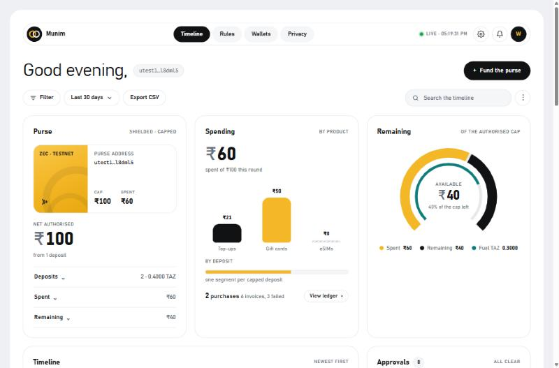

# Munim

> A household funds a shopping agent privately in shielded ZEC, with the spending cap written in the memo; the agent buys real Indian top-ups, gift cards and groceries when a rule fires, and every receipt comes back to the funder's wallet as an encrypted memo.

| | |
|---|---|
| **Track** | Privacy, and Agentic Commerce (entered in both) |
| **Privacy theme(s)** | 1. Private payment rails (capped agent wallet, MCP server) · 3. Privacy beyond the transaction (view-only export, receipts in encrypted memos) |
| **What it is** | agent + installable web app (PWA) + library with an MCP server (`packages/zcash-purse`) |
| **Live URL** | https://munim.heneryshop.com (password-protected because purchases are real; ask for the demo password in the mentor chat) |
| **Demo video** | https://munim.heneryshop.com/demo.mp4 (2:26, phone + laptop, every step real) |
| **Testnet txid** | `0c7247b5c65fd308cad895f9c798583ca12ffe4a90fa7efe25d257319b7291c6` · https://zexplorer.app/testnet/tx/0c7247b5c65fd308cad895f9c798583ca12ffe4a90fa7efe25d257319b7291c6 |
| **Real purchase invoice ID** (Agentic Commerce) | `7827bbf6-1825-4b00-8598-abbfaa1b92dd` (₹250 Swiggy Money card, delivered) |
| **Team** | Harsh Agarwal (@0xStoneyStark) + Claude (Fable 5.1 orchestrating the build, Sonnet 5.5 inside the agent, Opus and Sonnet subagents) |

*Munim* (मुनीम) is the family accountant in an Indian trading house: trusted with a purse, never with the vault.

---

## 1. The problem and who it's for

- **User:** one person in an Indian household (the funder) who pays for the family's recurring small things: a parent's prepaid plan, a monthly medicine card, a treat for mom, an evening grocery run.
- **Problem:** to let an agent do this today you hand it a card, a UPI PIN or a wallet with no limit, and the payment trail (who paid, how much, for what) is visible to the payment rail. Nothing bounds what the agent may spend, and nothing gives the funder a private receipt.
- **Evidence:**
  - The builder's own household is the first user. The hosted instance runs their real Jio plan, Swiggy and Instamart rules (see section 4).
  - The Agentic Commerce brief says the Bitrefill Assistant "has no budget, approval or receipt layer". Munim is that layer.
  - The Privacy brief lists capped agent wallets and MCP servers for agents under Theme 1, and invoices in encrypted memos under Theme 3.
  - Ecosystem gaps we hit and filed upstream during the hack: [zcash/zcash-devtool#272](https://github.com/zcash/zcash-devtool/issues/272), [bitrefill/agents#19](https://github.com/bitrefill/agents/issues/19). Swiggy has no public voucher-redeem API (see [FEEDBACK.md](FEEDBACK.md)).
  - We did not interview other users and claim none.

## 2. What it does

A funder sends shielded TAZ to the purse with a memo such as `fund cap=300 INR reply=utest1…`. The purse decrypts the memo with its viewing key and raises the cap by that amount. Rules then trigger purchases with nobody typing "buy": a clock time (`at 19:05`, chosen days, IST), an interval, a named signal, or a trip found in the funder's calendar. A Sonnet 5.5 agent picks the product within the rule's ceiling. The purse checks the cap before any Bitrefill invoice exists, and the agent buys through Bitrefill and polls the order until it is delivered. A Swiggy Money card is then redeemed into the household's Swiggy balance and can be spent on Instamart through Swiggy's official MCP server. A receipt goes back to the funder as an encrypted memo, with the code hashed and never sent.



```
funder ──shielded TAZ + memo "fund cap=… INR reply=utest1…"──▶ purse (agent wallet; viewing key watches)
                                                                  │
rule fires (clock / interval / signal / calendar) ──▶ Sonnet 5.5 agent ──search/price──▶ Bitrefill (real invoice, real delivery)
                                      │  purse.check / purse.reserve (cap enforced before any invoice)
                                      ▼
            Swiggy Money card ──auto-redeem──▶ household Swiggy balance ──Swiggy Instamart MCP, SwiggyPay──▶ groceries at the door
                                      │
funder ◀──shielded dust tx, memo "munim receipt inv=… item=… inr=… code_sha256=…"──── purse
```

The dashboard is an installable PWA with these pages: `/` (timeline), `/approvals` (eSIM and other proposals), `/rules` (plain-language rule creation with a readback, edit, and **Fire now** on any rule), `/wallets` (purse, funders, merchant balances), `/privacy` (what each party sees) and `/connections` (status, link and test for every integration).

### Beyond the core loop

| Piece | What it does | Where |
|---|---|---|
| **Close the loop on Swiggy** | A delivered Swiggy Money card is redeemed into the funder's Swiggy balance by the agent (private claim endpoint, the user's own session), then spent on **Instamart through Swiggy's official MCP** (`/im`) with `paymentMethod: SwiggyPay`: no UPI, no human tap | `swiggy-money.ts`, `swiggy-mcp.ts`, `instamart.ts`, `mcp-bridge.ts` |
| **Two Bitrefill surfaces** | Catalog discovery through Bitrefill's official MCP (`search-products`, `get-product-details`); the money path goes through REST behind the cap | `bitrefill-mcp.ts`, `agent.ts` |
| **Clock triggers** | `at HH:MM` with optional days and time zone (default IST), fires once a day; **Fire now** runs any rule from the dashboard | `rules.ts`, `run.ts`, `/rules` |
| **Calendar → eSIM** | Reads Google Calendar and Gmail booking emails (community MCP servers over stdio) or an ICS feed, detects international trips and proposes the right Bitrefill eSIM for the destination and trip length. You approve it on the dashboard or in Telegram. After purchase the LPA activation renders as a **QR code** (encoder written in-page, checked against `qrcode`/`jsqr`) | `travel.ts`, `google-mcp.ts`, `dashboard.html` |
| **Plain-language rules** | Type a sentence → structured rule + readback + warnings → confirm → saved | `rule-builder.ts`, `/rules/propose` |
| **Shop from chat** | Telegram bot: `/status`, `/fire`, `/approve`; sentences become rules with Confirm/Edit/Discard buttons; push alerts for proposals and purchases | `telegram.ts` |
| **Verifiable receipt** | Paste a decrypted receipt memo → checks the Bitrefill invoice, delivery, face value, code hash and the ledger's receipt txid | `/verify`, `verify.ts` |
| **Agent-to-agent payment** | `purse_pay` on the purse MCP: shielded ZEC + encrypted memo to another agent, inside the cap; transparent addresses refused | `packages/zcash-purse` ([README](packages/zcash-purse/README-purse.md)) |
| **Household funders** | Each funder (identified by `reply=` address) gets a cap, FIFO allocation of spends and their own receipts | `api-views.ts` |
| **Network privacy** | `PURSE_CONNECTION=tor` routes light-wallet traffic through devtool's built-in Tor client (tested) | `packages/zcash-purse/src/devtool.ts` |
| **Noir Wallet** | "Fund with Noir Wallet" on the dashboard uses the Noir SDK (`sendTransaction` with the cap memo) against the testnet extension build | `dashboard.html`, `noir-sdk.bundle.js` |

## 3. Try it in 5 minutes

**Without installing anything:**
1. Open https://munim.heneryshop.com. Ask for the demo password in the mentor chat (https://t.me/+QHbTGB6jFhllMDk6). On Android Chrome you can install it from the menu (**Install app**).
2. Look through `/` (timeline), `/rules`, `/approvals`, `/wallets`, `/privacy` and `/connections`. Paste a receipt memo into `/verify`.
3. You should see the funding deposits with their decrypted caps, the Bitrefill purchases with status, receipt txids linking to the explorer, and the cap refusals. Please do not press **Fire now** on a buying rule without asking first: purchases are real money.

**Run it locally** (about 15 minutes, 6 of them for the Rust build):

```bash
git clone https://github.com/0xStoneyStark/munim
cd munim

# Zcash testnet wallet CLI (one-time build, ~6 min)
git clone --depth 1 https://github.com/zcash/zcash-devtool tools/zcash-devtool
(cd tools/zcash-devtool && cargo build --release)

# the purse wallet + a view-only twin
DT=tools/zcash-devtool/target/release/zcash-devtool
$DT wallet -w wallets/agent init --name agent -i wallets/agent-identity.txt -n test
$DT wallet -w wallets/agent sync
$DT wallet -w wallets/agent list-accounts     # copy the UFVK and seed fingerprint
$DT wallet -w wallets/agent-view init-fvk --name view --fvk <UFVK> --seed-fingerprint <fp> --hd-account-index 0

cp .env.example .env   # BITREFILL_API_KEY (bitrefill.com/account/developers), ANTHROPIC_API_KEY (console.anthropic.com),
                       # TOPUP_PHONE (E.164), ZCASH_DEVTOOL (absolute path to the binary above);
                       # optional: DASHBOARD_PASSWORD, PURSE_CONNECTION=tor, MUNIM_TZ, RULES_FILE,
                       # TELEGRAM_BOT_TOKEN + TELEGRAM_ALLOWED_CHAT_IDS, GOOGLE_OAUTH_CREDENTIALS or CALENDAR_ICS
npm install
npm run check                    # Bitrefill auth + balance, purse sync + budget, keys present

npm run purse -- address         # give this address to the funder
npm run dashboard                # http://localhost:8788
npm run agent                    # agent loop: checks every 30 s, fires due rules
npm run agent -- --signal treat  # fire the rule listening for "treat" now
```

Fund the purse from any testnet wallet: send at least 0.01 TAZ with memo `fund cap=100 INR reply=<your utest1 address>`. The agent picks the deposit up on its next pass, after 10 confirmations (about 4 minutes at 25 s blocks). Rules live in [`apps/munim/rules.json`](apps/munim/rules.json), or in the file named by `RULES_FILE`. Swiggy is optional: `npm run swiggy:login` for the Instamart MCP. [CHECKLIST.md](CHECKLIST.md) walks through every integration without buying anything.

As an MCP server for any agent: `npm run purse:mcp` (stdio). Its tools are `purse_address`, `purse_refresh`, `purse_budget`, `purse_ledger`, `purse_check`, `purse_record_spend`, `purse_send_receipt` and `purse_pay`. Config for Claude Code, Claude Desktop and Cursor is in [packages/zcash-purse/README-purse.md](packages/zcash-purse/README-purse.md). Hosting: [deploy/README-deploy.md](deploy/README-deploy.md).

**Requirements:** Node 20+ (built on Node 24), a Rust toolchain for `zcash-devtool`, a Bitrefill account with balance (for real purchases), and an Anthropic API key.

**Test funds:** testnet TAZ from https://fauzec.com or https://faucet.testnet.valargroup.dev/, or from a Zcash mentor in the chat. No pre-funded wallet or seed is shared. For Bitrefill there is no test product, so the cheapest real purchase is ₹10 Jio talktime ($0.11). Without a Bitrefill balance, the cap logic still runs: `npm run purse -- check 1000` is refused and `npm run purse -- check 10` passes, and the dashboard works.

## 4. What actually works

All on 4 Nov 2026, Zcash testnet (NU7) and the live Bitrefill API.

**The full loop, unattended (evening of 4 Nov).** No human touched anything after the rules were saved.

| Step in the core flow | Status | Evidence |
|---|---|---|
| Funder raises the cap with a shielded deposit, memo `fund cap=300 INR` | ✅ real | [`cab9836098f427ba8045b058eec8ee4c59f00347ffdb7eb3c46187cd67901acb`](https://zexplorer.app/testnet/tx/cab9836098f427ba8045b058eec8ee4c59f00347ffdb7eb3c46187cd67901acb) |
| The `topup` rule buys a ₹250 Swiggy Money card from the Bitrefill balance, after the cap check | ✅ real | Bitrefill invoice `7827bbf6-1825-4b00-8598-abbfaa1b92dd`, order `6aeb342286d3593f5096224f`, **delivered**, $2.75 |
| The card is auto-redeemed into the household Swiggy balance | ✅ real (private endpoint, see limitations) | Swiggy Money ₹50 → ₹300; the code never left the process, and only amounts were logged |
| Purse → funder receipt memo | ✅ real | `9447c5de…` (full txid in the server ledger) |
| The `daily-diet-coke` rule (trigger `at 19:05` IST) fires on the server's agent loop | ✅ real | fired 19:05:07 IST (agent run log) |
| Agent drives Swiggy's official Instamart MCP: search → cart (2 × Diet Coke) → read the bill → `checkout` with `paymentMethod: SwiggyPay` | ✅ real | **"Instamart order placed successfully! Order ID: 252768923926074. Payment done via Swiggy Money."** Delivered to the saved address. |

**Earlier runs the same day**

| Step in the core flow | Status | Evidence |
|---|---|---|
| Funder → purse, 0.1 TAZ, memo `fund cap=100 INR reply=utest1…` | ✅ real | [`0c7247b5c65fd308cad895f9c798583ca12ffe4a90fa7efe25d257319b7291c6`](https://zexplorer.app/testnet/tx/0c7247b5c65fd308cad895f9c798583ca12ffe4a90fa7efe25d257319b7291c6) (mined 4581752, shielded) |
| `jio-recharge` fired on schedule → Sonnet picked ₹10 Jio talktime → `purse_check` ✓ → bought | ✅ real | invoice `3bb79e4e-6d7a-4b56-a921-07e5cb060f89`, order `6aeb0da57073473b2edcb0fd`, **delivered**, $0.11 |
| Receipt memo `munim receipt inv=3bb79e4e… item=Jio Bundles India inr=10 cost=0.11 USD rule=jio-recharge` | ✅ real | [`4377c5c7acdbd4239a87c574aee8f070b1dc84d963c09804a7376824e4042461`](https://zexplorer.app/testnet/tx/4377c5c7acdbd4239a87c574aee8f070b1dc84d963c09804a7376824e4042461) (mined 4581796; decrypted in the funder's wallet with `zcash-devtool wallet list-tx`) |
| Signal `treat` → ₹50 Swiggy Money card, code hashed | ✅ real | invoice `599b5c2f-aba9-4774-8d2d-676d2e64b373`, order `6aeb0e027073473b2edcb9d5`, **delivered**, $0.55 |
| Receipt for the Swiggy card (sent on the next pass, after the purse's change note confirmed) | ✅ real | [`3552ff34bbf513e269fc88bef1dc4cb7609aee68ad87fb5c043125de3966557b`](https://zexplorer.app/testnet/tx/3552ff34bbf513e269fc88bef1dc4cb7609aee68ad87fb5c043125de3966557b) |
| First close-the-loop redeem of that card into Swiggy Money | ✅ real | `credited 50 INR, balance now 50 INR (Completed)` |
| Signal `treat` again → `purse_check ₹50: ₹50 exceeds remaining cap ₹40` → **refused**, no invoice | ✅ real | agent log: the purse refused, and the agent did not try Zomato because the same limit applies |
| Jio *data add-on* ₹11 (earlier attempt) | ✅ real (refunded) | invoice `efa3987e-ef86-45c7-83a7-f93a52442e22` was **refunded** by Bitrefill (data packs need an active base plan). The ledger records it as `refunded`, not against the cap |
| Calendar → eSIM: flights `BOM → DXB` 15–20 Nov read through the Google Calendar and Gmail MCPs | 🟡 partial (proposed, not bought) | proposal `22ca92db`: `bitrefill-esim-united-arab-emirates · 1GB, 7 Days · 3.76 USD`, waiting for a human Approve |
| Agent-to-agent payment: `purse_pay` 0.0001 TAZ, memo `munim pay purpose=mcp-pay-test inr=1 …` | ✅ real | [`e03a2b3ca20c85c20448e6a59d2e51c9fc54cfe3896ec13c43789b10b57dee22`](https://zexplorer.app/testnet/tx/e03a2b3ca20c85c20448e6a59d2e51c9fc54cfe3896ec13c43789b10b57dee22) (counted against the cap) |

**Known limitations:**
- Swiggy voucher redemption calls a private endpoint (the one Swiggy's own webview uses) with the user's own saved web session. Swiggy has no public API for it.
- The public redirect URL for the Swiggy MCP OAuth is not whitelisted yet. The hosted instance uses a token obtained on `localhost` and synced to the server (whitelisting requested through Builders Club).
- The Google OAuth app is in testing mode, so Calendar and Gmail tokens expire after 7 days and must be re-authorised.
- Everything runs as root on a shared VPS (pm2, no sandbox). See [deploy/README-deploy.md](deploy/README-deploy.md) §5.
- Bitrefill does not accept ZEC, so ZEC → Bitrefill is settled by the operator. The ZEC leg authorises and audits; the operator's Bitrefill balance pays.
- The Instamart order is not recorded as a purse spend, only in the run log. The cap counted the ₹250 card that funded it, not the order.
- The cap is enforced in software by the operator. The only hard bound is the amount of TAZ deposited.

## 5. Privacy and trust

The full note is in [PRIVACY.md](PRIVACY.md). Summary:

1. **What stays private?** Every on-chain movement is shielded-to-shielded (NU7 testnet, Ironwood): sender, receiver and amount are hidden. The funding memo (cap and reply address) is encrypted to the purse, and the receipt memo (invoice, item, INR, code hash) is encrypted to the funder. Redemption codes never leave the Bitrefill order or the redeem call: only `sha256(code)` is stored, sent or shown to the model. The funder's spending key never touches Munim, and the dashboard and the accountant's CSV export read a **view-only** wallet.
2. **What does the app reveal, and to whom?**
   - **What the agent sees and stores:** the model sees each rule's intent, Bitrefill search results and prices, cap verdicts, and invoice id / order status / code hash. It never sees the purse key, the API keys, the funder's address or a code. The server stores the ledger (deposits, caps, spends, invoice ids, code hashes), the funder's reply address, the rules and the top-up phone number, all in plaintext JSON on the operator's disk.
   - **Bitrefill** sees the operator's account, every purchase, the top-up phone number and the server's IP. It never sees any Zcash activity.
   - **Swiggy** sees the redeems, Instamart orders, the delivery address and the server's IP. The operator holds the user's Swiggy session and MCP token.
   - **Anthropic** (model provider) sees what is listed under "What the agent sees" above.
   - **Google**, if the calendar rule is on: the server holds read tokens for Calendar and Gmail. Email bodies are parsed in memory and not logged.
   - **The light-wallet server** (`testnet.zec.rocks`) sees the server's IP and sync pattern, unless `PURSE_CONNECTION=tor` is set.
   - **The chain** shows only that shielded transactions happened.
3. **Who do users have to trust?** The operator, who holds the purse key, the Bitrefill key and any merchant sessions, and who enforces the cap in software. Saving a Swiggy session lets the operator spend the existing Swiggy balance too, not only what the purse funded. Also: Bitrefill (delivery, account safety), Swiggy, Anthropic, Google (if used), the hosted light-wallet server, the VPS (shared, root), and this code, including `zcash-devtool`, which its own README says is not production-ready.
4. **What would you fix next?** Take the spend key out of the agent process (devtool's PCZT flow, then FROST 2-of-3 with the funder) so the cap is enforced by keys, not by trusting the operator. Move the phone number and intents into the encrypted funding memo. Encrypt the ledger at rest. Replace the Swiggy web session with scoped OAuth. Batch receipts to blur timing. Use Nym for the sync pattern.

**Viewing key (optional):** N/A. Not published for this submission.

## 5b. Agentic commerce with Bitrefill

This is section 5 of the Agentic Commerce template, added here for our dual-track entry.

- **What the agent does on its own:** a rule fires (clock, interval, signal) → the agent searches the Bitrefill catalog → picks a product and package within the rule's ceiling → the purse checks and reserves the cap → the agent creates and pays the invoice from balance → it polls the order until `delivered` → it redeems Swiggy Money cards into the household balance → it spends that balance on Instamart through Swiggy's MCP → it sends the receipt memo. A human sets the rules and the cap (by deposit), and approves eSIM proposals. Nothing else is human.
- **Bitrefill integration:** two surfaces. The official **eCommerce MCP** (`https://api.bitrefill.com/mcp`, Bearer key) handles discovery: `search-products` and `get-product-details` are bridged into the Anthropic tool runner ([`bitrefill-mcp.ts`](apps/munim/src/bitrefill-mcp.ts), [`mcp-bridge.ts`](apps/munim/src/mcp-bridge.ts)). `buy-products` is deliberately not given to the model. **REST API v2** handles the money path ([`bitrefill.ts`](apps/munim/src/bitrefill.ts)): `/accounts/balance`, `/products/{id}` for exact packages and prices, `POST /invoices` with `payment_method: balance, auto_pay: true`, and `/orders/{id}` polled until `delivered`. Built: the rules engine, the capped purse, the agent with tool-enforced guardrails, the receipt format and the close-the-loop stage. Reused: Bitrefill's catalog, pricing and fulfilment.
- **Payment method:** Bitrefill account balance, which is USD store credit bought with ETH. ZEC is not accepted by Bitrefill: the shielded ZEC deposit authorises the budget and the receipts audit it, while the operator's balance settles the payment. Instamart orders are paid from Swiggy Money (`SwiggyPay`).
- **Guardrails:**
  - **Per purchase:** the rule's `maxInr` (for example ₹60 for `treat-for-mom`, ₹300 for the Jio plan).
  - **In total:** the purse cap, which is the sum of memo-authorised deposits, enforced in `Purse.reserve()` before any invoice is created.
  - **Per day:** Bitrefill's own account caps (5 top-ups, 15 gift cards).
  - **One invoice per rule firing.**
  - **eSIMs** need a human **Approve** on the dashboard.
  - **Instamart budget** is `min(rule max, Swiggy Money balance)`, checked against the full bill including fees.
  - **Above the cap**, nobody can approve a purchase. The only way to raise it is a funder sending a new shielded deposit with a new `cap=` memo.
- **Purchase proof:** invoice `7827bbf6-1825-4b00-8598-abbfaa1b92dd` (delivered, bought unattended by the `topup` rule), then Instamart order `252768923926074` paid with Swiggy Money. Video timestamps: shielded deposit 0:07, explorer 0:16, top-up fired 0:51, delivered 1:00, receipt verified 1:08, privacy note 1:23, eSIM proposal from the calendar 1:29, Swiggy Money card and the Instamart order 1:37, push notification 1:53.
- **What's new here:** a new **guarantee** (the budget is a private, memo-authorised cap that the model cannot raise, and receipts are encrypted to the funder). A new **trigger** (clock, calendar and signal rules: no prompt). A new **ending**: the card does not stop at "delivered"; it is redeemed and spent on groceries that arrive at the door.

## 6. How it's built

- **Technologies used:** TypeScript on Node 24 (runs on Node 20.3+) · `@anthropic-ai/sdk` 1.4.0 (Claude Sonnet 5.5, beta tool runner, Zod tools) · `@modelcontextprotocol/sdk` 1.32.2 · `zod` 4.6.7 · `tsx` 4.23 · `dotenv` 16.6 · `@noir-wallet/sdk` 0.1.9 · `zcash-devtool` (Rust, commit `0b3436b`; `zcash_client_sqlite`, NU7 testnet via `testnet.zec.rocks`, optional built-in Tor) · Bitrefill eCommerce MCP + REST API v2 · Swiggy official MCP (Instamart `/im`, OAuth 2.1 PKCE with dynamic client registration) · community Google Calendar and Gmail MCP servers (`@cocal/google-calendar-mcp`, `@gongrzhe/server-gmail-autoauth-mcp`) · Telegram Bot API · plain `node:http` dashboard + PWA (manifest, service worker) · nginx + certbot + pm2 on a Hetzner VPS.
- **Architecture:**

  ```
  [Funder wallet] ──shielded TAZ + memo──▶ [Zcash testnet] ◀── [lightwalletd: testnet.zec.rocks] ◀── [zcash-purse (devtool wrapper, ledger, MCP)]
                                                                                                          │ cap check / reserve / receipt
  [Dashboard PWA, Telegram] ──▶ [Munim agent loop (rules)] ──▶ [Sonnet 5.5 agent] ──▶ [Bitrefill MCP (discover) + REST v2 (buy, balance)]
                                                                     └──▶ [Swiggy Money redeem] ──▶ [Swiggy Instamart MCP (SwiggyPay)]
  ```

- **Code worth reading:**
  - [`packages/zcash-purse/src/index.ts`](packages/zcash-purse/src/index.ts): the purse. Memo-parsed caps, the pure `check()`, `reserve()` that throws over the cap, receipt memos, and `pay()` that refuses transparent addresses.
  - [`packages/zcash-purse/src/mcp.ts`](packages/zcash-purse/src/mcp.ts): the purse as an MCP server any agent can use. It cannot raise its own cap.
  - [`packages/zcash-purse/src/devtool.ts`](packages/zcash-purse/src/devtool.ts): a typed wrapper over `zcash-devtool` (sync + enhance for memos, signed amounts, Tor).
  - [`apps/munim/src/agent.ts`](apps/munim/src/agent.ts): the agent's four tools. `buy` calls the purse before Bitrefill and returns only a code hash.
  - [`apps/munim/src/run.ts`](apps/munim/src/run.ts) and [`rules.ts`](apps/munim/src/rules.ts): the unattended loop and the trigger schema (interval, signal, `at HH:MM` + days + tz, calendar).
  - [`apps/munim/src/instamart.ts`](apps/munim/src/instamart.ts): the spend stage. Budget on the full bill, `SwiggyPay` only, cart cleared if it does not fit.
  - [`apps/munim/src/mcp-bridge.ts`](apps/munim/src/mcp-bridge.ts): any MCP server's tools become Anthropic tool-runner tools, with schemas passed through untouched.
  - [`apps/munim/src/verify.ts`](apps/munim/src/verify.ts): checks a decrypted receipt memo against Bitrefill and the ledger.
- **Built during the hack vs before:** everything in this repo was written during the hack on 4 Nov 2026 (see the commit history). Reused: `zcash-devtool`, the SDKs listed above, and the Bitrefill, Swiggy and Google services.
- **Reusable parts:** `packages/zcash-purse`, a capped, memo-receipting shielded purse with its own MCP server and no dependency on the app ([README](packages/zcash-purse/README-purse.md)). Also the memo grammar (`fund cap=… reply=…`, `munim receipt …`, `munim pay …`), the generic MCP → tool-runner bridge, and two upstream issues with a PR offered.

**Which track gets what**

| | Privacy (Zcash) | Agentic Commerce (Bitrefill) |
|---|---|---|
| Piece | `packages/zcash-purse`: capped shielded purse, memo grammar, receipt memos, view-only export, MCP server with `purse_pay`, `/verify`, Tor, Noir funding | `apps/munim`: rules and triggers, Sonnet 5.5 agent, Bitrefill MCP + REST, Swiggy close-the-loop, calendar → eSIM, dashboard, Telegram |
| Theme / lane | Private payment rails + Privacy beyond the transaction | Rails and guardrails · Close the loop · No prompt required · Private by default |
| Evidence | shielded testnet txids (funding, receipts, agent-to-agent) | delivered invoice ids + Instamart order |

**Design decisions**

- **devtool over an SDK.** On NU7 testnet, WebZjs and the published CLIs were broken or needed Docker. `zcash-devtool` built and synced the first time. Wrapping a CLI is less elegant than linking a library, but it works, and "Works" is the first criterion.
- **Cap in the memo, not in a config file.** The funder's authorisation travels with the money, encrypted. The operator cannot invent a cap without a deposit behind it.
- **Receipt as a dust transaction.** 0.0001 TAZ carries a 512-byte encrypted memo to the funder's wallet. It costs a fee, but the funder needs nothing except their wallet to audit the agent.
- **Hash the code, don't forward it.** The model and the memo get `sha256(code)`, and the code is used only inside the redeem call. No code ever sits in a log.
- **Discover over MCP, buy over REST.** The model gets the read-only catalog tools. Every money call goes through code that checks the cap first.
- **Operator-settled Bitrefill.** ZEC is not accepted, and the testnet has no swap path. We state this trust gap openly instead of hiding it.

## 7. What's next (30 days)

- **Next milestone:** publish `@munim/zcash-purse` as a standalone npm package + MCP server (one `npx` command for any Claude Code, Cursor or Claude Desktop agent), and move the spend key into a separate PCZT signer. Target: Fri 4 Dec 2026.
- **Who benefits:** the builder's household, which is the pilot already running on the hosted instance, and any agent builder who needs a capped shielded wallet with receipts.
- **Already started:**
  - Upstream issues [zcash/zcash-devtool#272](https://github.com/zcash/zcash-devtool/issues/272) (memo decryption needs `enhance`, `list-tx --json`, unsigned send amounts; PR offered) and [bitrefill/agents#19](https://github.com/bitrefill/agents/issues/19) (MCP auth docs, TOON output, voucher format).
  - The hosted, installable instance at https://munim.heneryshop.com, running the household rules.
  - A Swiggy Builders Club whitelisting request for the public OAuth redirect.

  The full plan is in [NEXT.md](NEXT.md).

## 8. Links

- Repo: https://github.com/0xStoneyStark/munim
- Demo video: https://munim.heneryshop.com/demo.mp4
- Live app: https://munim.heneryshop.com
- Slides (optional): N/A

## Feedback

See [FEEDBACK.md](FEEDBACK.md): what broke, confused or slowed us down with Zcash, Bitrefill and Swiggy's MCP. For the Agentic Commerce track, the Bitrefill section is our required feedback.

## License

MIT. See [LICENSE](LICENSE).

---

## Resources used

- Privacy track brief: https://stadium.joinwebzero.com/programs/free-society-hack-2026/privacy/llms.txt
- Agentic Commerce track brief: https://stadium.joinwebzero.com/programs/free-society-hack-2026/agentic-commerce/llms.txt
- Testnet faucets: https://fauzec.com · https://faucet.testnet.valargroup.dev/
- Testnet explorer: https://zexplorer.app (`/testnet/tx/<txid>`)
- lightwalletd: https://github.com/zcash/lightwalletd (we use the hosted `testnet.zec.rocks`)
- zcash-devtool: https://github.com/zcash/zcash-devtool
- Bitrefill developer docs (API v2): https://docs.bitrefill.com · hosted eCommerce MCP: https://docs.bitrefill.com/docs/ecommerce-mcp
